<p align="center">
  
</p>

<h1 align="center">Radio Crestin</h1>

<p align="center">
  Romanian Christian radio in one app: 60+ stations, the song playing now, and playback that keeps going
  through a weak signal, on your phone, in the car, on the TV and on the desktop.
</p>

<p align="center">
  <a href="https://apps.apple.com/app/6451270471"></a>
  &nbsp;
  <a href="https://play.google.com/store/apps/details?id=com.radiocrestin.radio_crestin"></a>
</p>

<p align="center">
  <a href="https://github.com/radio-crestin/radio-crestin-mobile-app/releases/latest"></a>
  
  
</p>

<p align="center">
  
  
  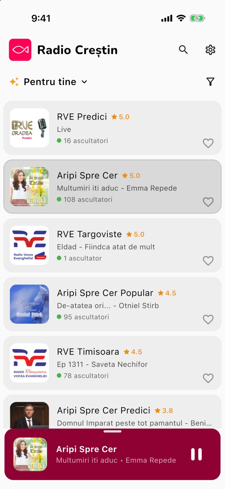
  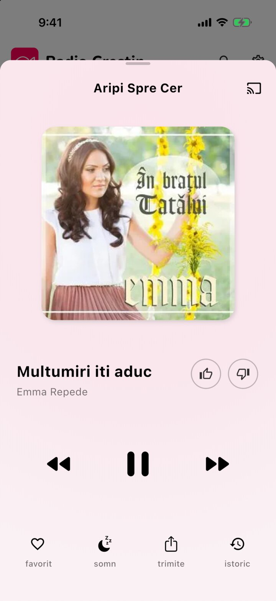
</p>

---

## Contents

- [Features](#features)
- [Get the app](#get-the-app)
- [How it works](#how-it-works)
- [Quick start for developers](#quick-start-for-developers)
- [Contributing](#contributing)

## Features

### Tap a station, and it plays

Every station shows the song on air and how many people are listening. Tap one and it starts at once, and
keeps playing with the screen locked or in another app. Heart your favorites and drag them into your own
order; CarPlay, Android Auto, the widgets and the TV follow it.

### Find the song you hear

Search matches station names **and** the song playing now, by title or singer, with the matching words in
bold. Case and diacritics don't matter. Categories (Muzică, Predici, Worship, Copii…) show as picture cards.

<p>
  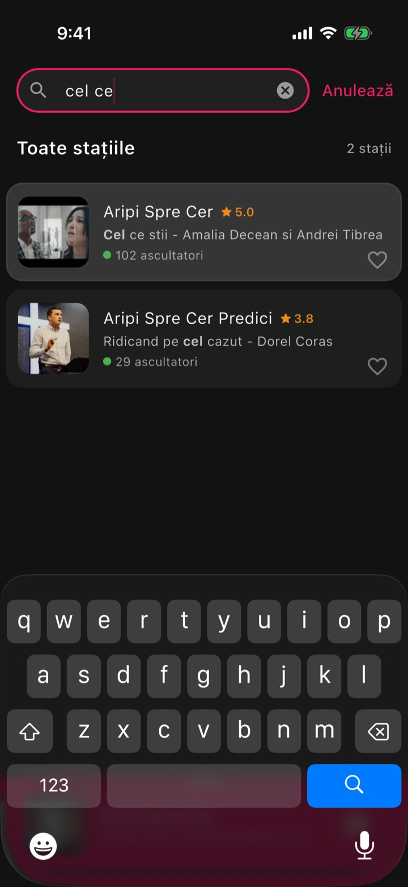
  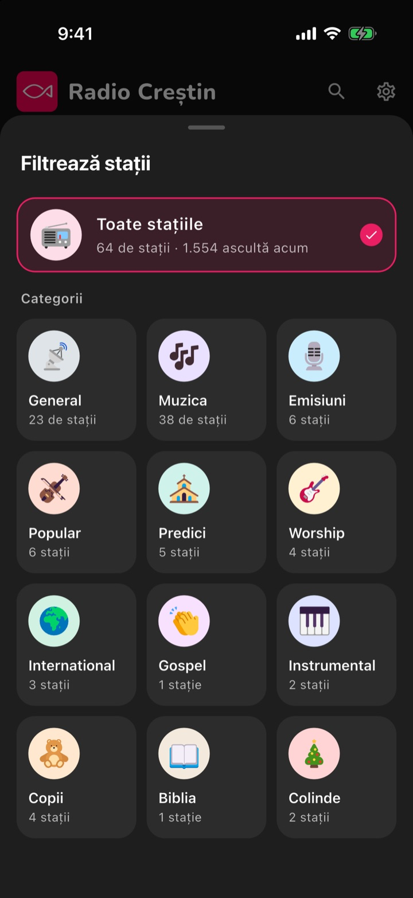
  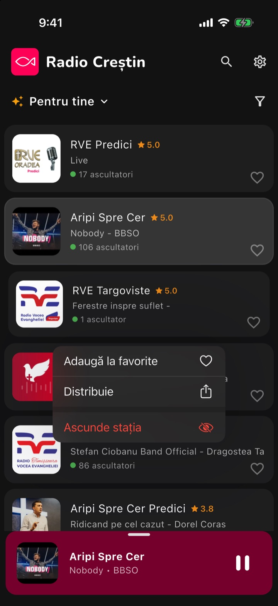
</p>

### A player built for listening

Like or dislike the song, see what played before, set a sleep timer that fades the volume out, and invite a
friend over WhatsApp or Facebook. Tap the title to find the song on YouTube. Phones and tablets get a
landscape layout too.

<p>
  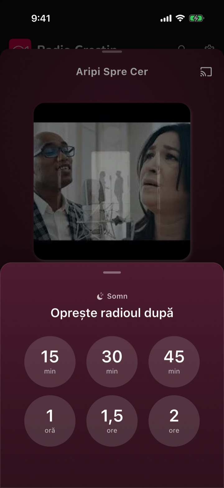
  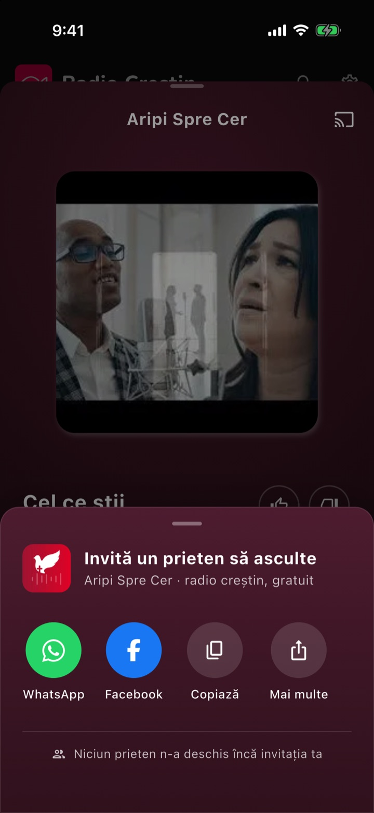
  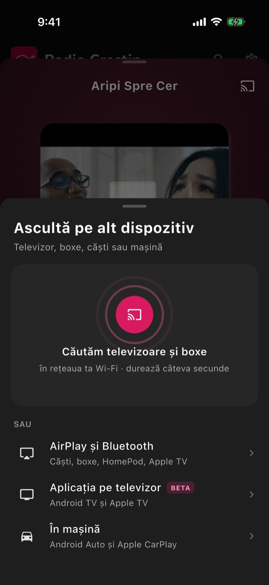
</p>
<p>
  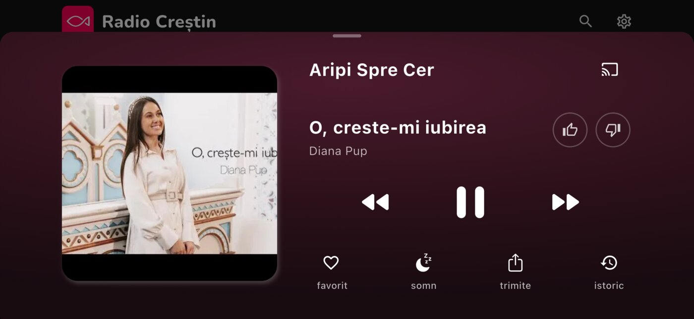
</p>

### Keeps playing through a weak signal

With **Încărcare în avans** (preload) set to 2 or 5 minutes, the app plays that far behind live and keeps
that much audio loaded, so a tunnel or a dead zone goes unheard. Each station has several streams, and the
app moves to the next one on its own when a stream fails. **Folosește MP3 cu prioritate** helps on networks
where a station won't start.

<p>
  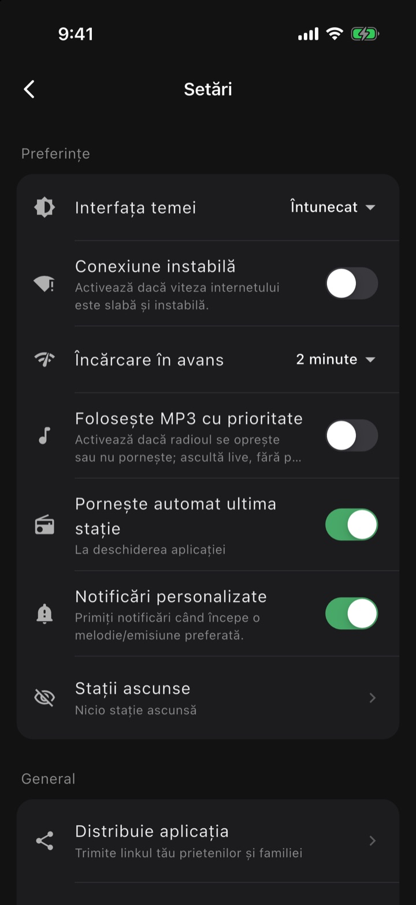
</p>

### Everywhere you listen

| Where | What you get |
|-------|--------------|
| **iPhone Home Screen** | **Acum ascult** (the song playing, with play/pause) and **Favorite** (one tap starts a station) widgets. Buttons work without opening the app on iOS 17+. |
| **Siri** | "Hey Siri, play *RVE Constanța* on Radio Creștin", also with the app closed or from the car's voice button. |
| **CarPlay and Android Auto** | Favorite and Categorii tabs, station logos, 👍 ♡ 👎 on Now Playing (Android Auto), a clear message when offline. |
| **Apple TV and Android TV** | A station grid made for the remote; favorites on the Android TV home screen. |
| **Mac and Windows** | A desktop app with a station grid, a player bar with volume, menus and keyboard shortcuts. |
| **Chromecast, Google speakers, AirPlay** | The cast button lists every device on your Wi-Fi in one sheet. |

<p>
  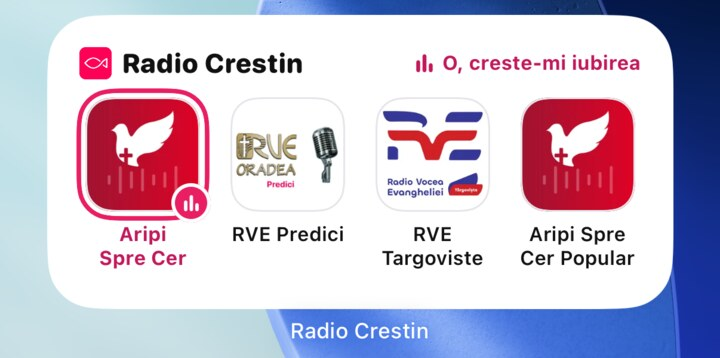
  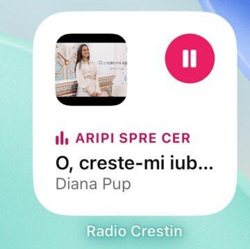
</p>
<p>
  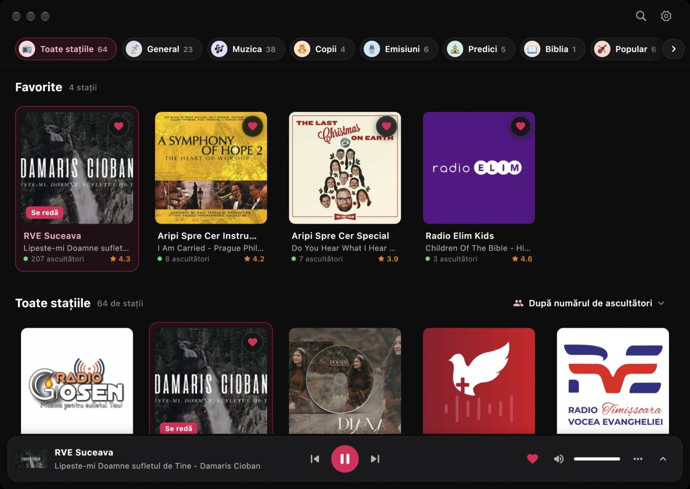
</p>
<p>
  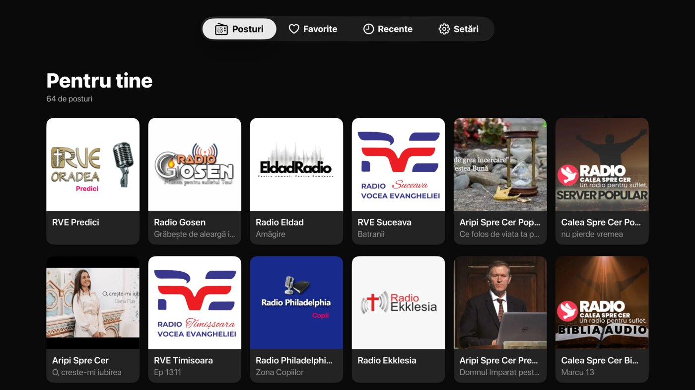
</p>

What changed in each version: [`release-notes/`](release-notes/README.md).

## Get the app

| Device | Install |
|--------|---------|
| iPhone, iPad, Apple TV, Mac | [App Store](https://apps.apple.com/app/6451270471) |
| Android phone, tablet, Android TV | [Google Play](https://play.google.com/store/apps/details?id=com.radiocrestin.radio_crestin), or the [APK](https://github.com/radio-crestin/radio-crestin-mobile-app/releases/latest/download/radio-crestin-android.apk) |
| Mac (without the App Store) | [DMG](https://github.com/radio-crestin/radio-crestin-mobile-app/releases/latest/download/radio-crestin-macos.dmg) |
| Windows 10/11 | [ZIP](https://github.com/radio-crestin/radio-crestin-mobile-app/releases/latest/download/radio-crestin-windows.zip) |
| CarPlay, Android Auto | Comes with the phone app |

Step-by-step setup for every device, including widgets, Siri, CarPlay, Android Auto and casting:
[`release-notes/SETUP.md`](release-notes/SETUP.md).

## How it works

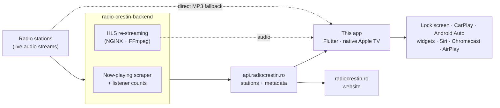

1. **The directory.** [radio-crestin-backend](https://github.com/radio-crestin/radio-crestin-backend)
   keeps the list of stations, reads the song each one is playing, counts listeners, and re-streams the
   stations as HLS so players can start behind live and buffer ahead. The same API also feeds the
   [radiocrestin.ro](https://github.com/radio-crestin/radiocrestin.ro) website and the
   [command-line player](https://github.com/radio-crestin/radiocrestin-cli).
2. **The app reads the API.** It loads the stations and keeps the song on air fresh while you look at the
   list. The last answer is cached, and a bundled list (`assets/fallback-stations.json`) covers the very
   first launch without internet, so the screen is never empty.
3. **One player, many screens.** `AppAudioHandler` (built on `audio_service` and `just_audio`) owns
   playback and app state. It tries a station's streams in order (HLS first, then MP3) and moves on when
   one fails; the lock screen, CarPlay, Android Auto, the widgets and Siri all drive this same player.
4. **Apple TV is native.** `apple_tv/` is a SwiftUI app that talks to the same API.

## Quick start for developers

### Prerequisites

- [FVM](https://fvm.app) (the project pins Flutter **3.47.7** in `.fvmrc`), or that Flutter version on your `PATH`.
- **iOS / macOS / tvOS:** macOS with Xcode and CocoaPods (`brew install cocoapods`).
- **Android:** Android Studio with an SDK for API 36, and an emulator or a device.

### Run it

```bash
git clone https://github.com/radio-crestin/radio-crestin-mobile-app.git
cd radio-crestin-mobile-app
fvm install                 # installs the pinned Flutter
fvm flutter pub get
fvm flutter run             # pick a simulator, emulator, device or desktop
```

Android builds also need `android/app/google-services.json` (Firebase, used for push notifications). It is
not in git: ask the maintainers for it, or create a Firebase project for the package
`com.radiocrestin.radio_crestin` and download its file. iOS and macOS already include theirs.

Desktop targets run the same way: `fvm flutter run -d macos`, `-d windows` or `-d linux`.

### Check your work

```bash
fvm flutter analyze
fvm flutter test                                             # the test suite
dart run build_runner build --delete-conflicting-outputs     # after editing a .graphql file
```

### Car and TV

| Target | How |
|--------|-----|
| CarPlay | Run on an iOS simulator, then in Simulator: **I/O → External Displays → CarPlay**. |
| Android Auto | `make install-android-auto-emulator`, then `make start-android-auto` (Desktop Head Unit). |
| Android TV | Run on an Android TV emulator; the D-pad drives the TV layout. |
| Apple TV | Open `apple_tv/RadioCrestinTV.xcodeproj` and run the `RadioCrestinTV` scheme (Debug). After editing `apple_tv/project.yml`, run `xcodegen generate` there. |

### Find your way around

| Path | What's there |
|------|--------------|
| `lib/appAudioHandler.dart` | Playback and the app-wide state (RxDart streams) |
| `lib/services/` | Station data, CarPlay/Android Auto, casting, widgets, Siri, sleep timer, analytics |
| `lib/components/`, `lib/pages/`, `lib/widgets/` | The UI |
| `lib/queries/` | GraphQL documents and their generated code (don't edit the `.graphql.dart` files) |
| `packages/` | Forked plugins: CarPlay/Android Auto, audio_service, Chromecast, AirPlay, D-pad |
| `apple_tv/` | The native tvOS app |
| `ios/RadioCrestinWidgets/` | The iOS Home Screen widgets |
| `cast_receiver/` | The Chromecast receiver page (Cloudflare Worker) |

Code conventions, architecture notes and pitfalls are in [`CLAUDE.md`](CLAUDE.md). Building and publishing
releases is in [`docs/releasing.md`](docs/releasing.md).

## Contributing

Issues and pull requests are welcome. Listener-visible changes get a line in the unreleased
[release notes](release-notes/README.md) in the same commit. Questions: **contact@radio-crestin.com**.

This project may be used only by Christian organizations, for non-commercial purposes.
