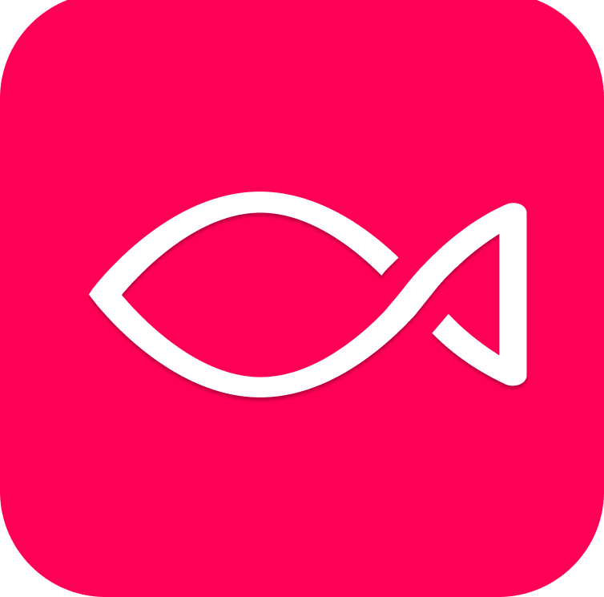
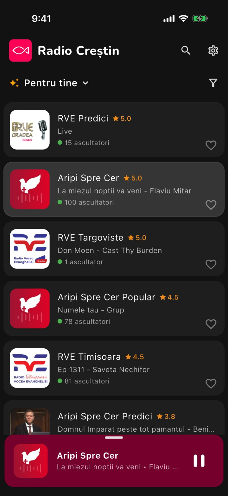
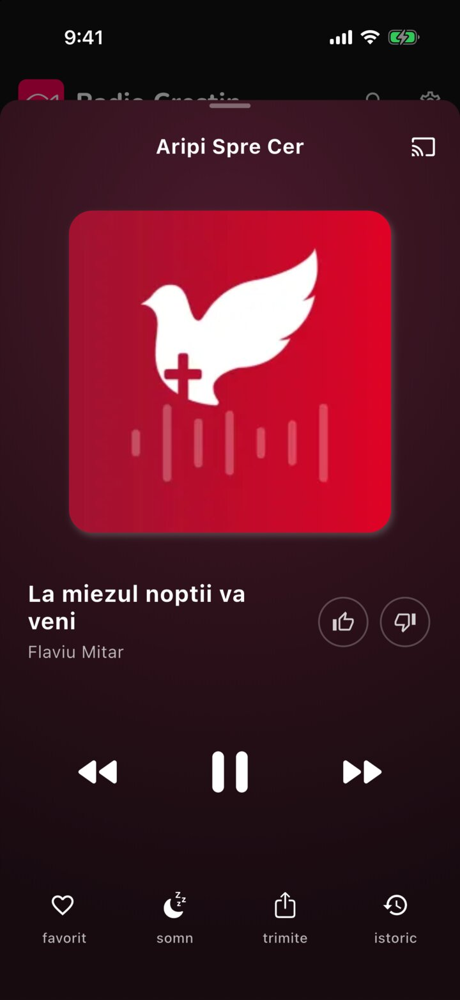
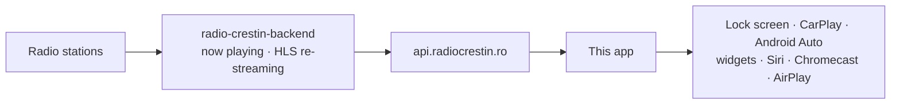

<p align="center">
  
</p>

<h1 align="center">Radio Crestin</h1>

<p align="center">
  Romanian Christian radio in one app: 60+ stations, the song playing now, on your phone, in the car,
  on the TV and on the desktop.
</p>

<p align="center">
  <a href="https://apps.apple.com/app/6451270471"></a>
  &nbsp;
  <a href="https://play.google.com/store/apps/details?id=com.radiocrestin.radio_crestin"></a>
</p>

<p align="center">
  
  &nbsp;&nbsp;
  
</p>

## ✨ Features

- 📻 **60+ Christian stations**, each with the song on air and how many people are listening
- ▶️ **One tap to play**, and it keeps playing with the screen locked or in another app
- 🔎 **Search by song**: type a title or a singer to find the station playing it
- ❤️ **Favorites in your own order**, plus categories and stations you can hide
- 👍 **Like, dislike and song history** for every song
- 📶 **Plays through a weak signal**: preload 2 or 5 minutes so tunnels and dead zones go unheard
- 😴 **Sleep timer** that fades the volume out
- 💬 **Share a station** on WhatsApp, Facebook or with a link
- 🚗 **CarPlay and Android Auto**
- 🗣️ **Siri**: "Hey Siri, play *RVE Constanța* on Radio Creștin"
- 📱 **Home Screen widgets** on iPhone
- 📺 **Apple TV and Android TV**
- 💻 **Mac and Windows** desktop apps
- 🔊 **Chromecast, Google speakers and AirPlay**
- 🌙 **Dark and light themes**

## 📲 Get the app

[App Store](https://apps.apple.com/app/6451270471) (iPhone, iPad, Mac, Apple TV) ·
[Google Play](https://play.google.com/store/apps/details?id=com.radiocrestin.radio_crestin) (Android, Android TV) ·
[GitHub releases](https://github.com/radio-crestin/radio-crestin-mobile-app/releases/latest) (APK, DMG, Windows ZIP)

Setup for every device: [`release-notes/SETUP.md`](release-notes/SETUP.md).

## ⚙️ How it works



[radio-crestin-backend](https://github.com/radio-crestin/radio-crestin-backend) keeps the station list,
reads the song each station plays and re-streams it as HLS. The app (Flutter, plus a native SwiftUI Apple
TV app in `apple_tv/`) reads that API and plays each station's streams in order, HLS first, then MP3, moving
on when one fails. The same API feeds the [radiocrestin.ro](https://github.com/radio-crestin/radiocrestin.ro)
website.

## 🛠️ Quick start for developers

Needs [FVM](https://fvm.app) (Flutter **3.47.7** is pinned in `.fvmrc`), plus Xcode and CocoaPods for
Apple platforms and Android Studio for Android.

```bash
git clone https://github.com/radio-crestin/radio-crestin-mobile-app.git
cd radio-crestin-mobile-app
fvm install && fvm flutter pub get
fvm flutter run          # simulator, emulator, device, or -d macos / windows / linux
fvm flutter analyze
fvm flutter test
```

Android builds also need `android/app/google-services.json` (Firebase, for push notifications). It isn't in
git, so ask the maintainers for it.

Conventions and architecture: [`CLAUDE.md`](CLAUDE.md) · Releasing: [`docs/releasing.md`](docs/releasing.md)

## 🤝 Contributing

Issues and pull requests are welcome. Questions: **contact@radio-crestin.com**.

This project may be used only by Christian organizations, for non-commercial purposes.
