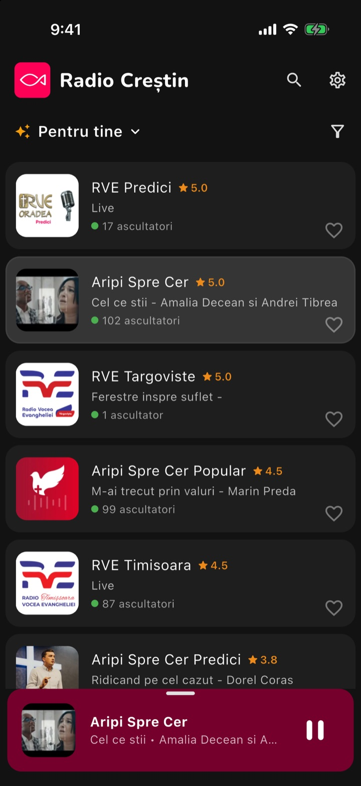
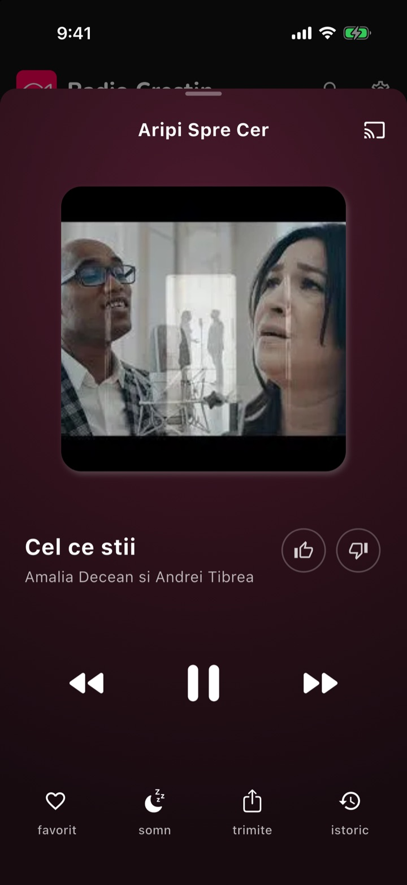
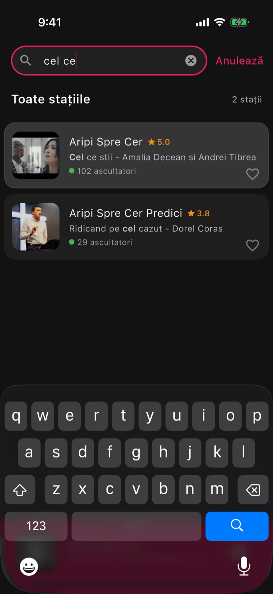
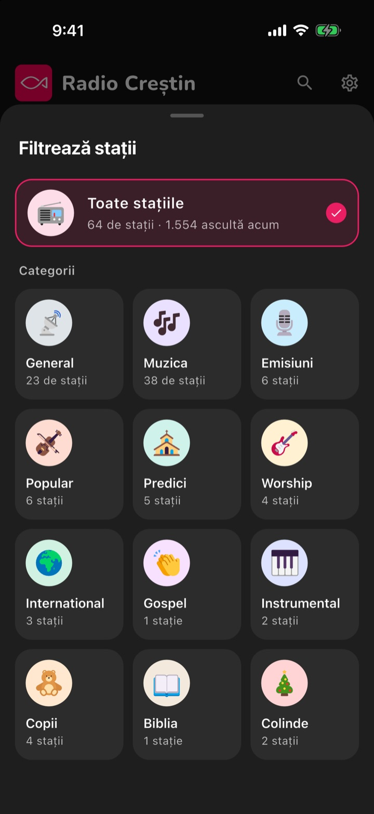
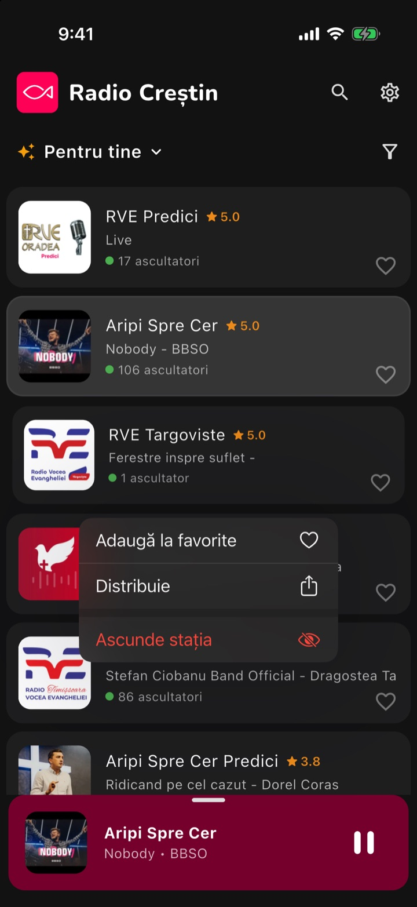
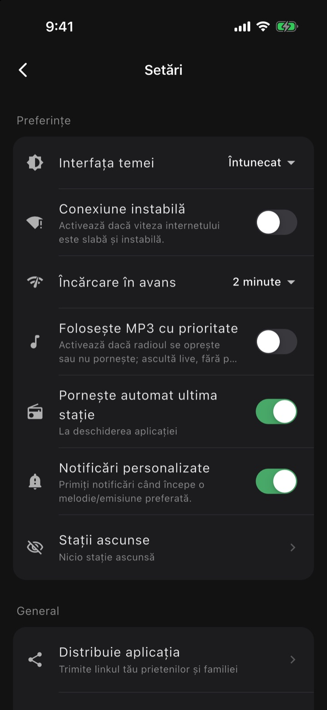
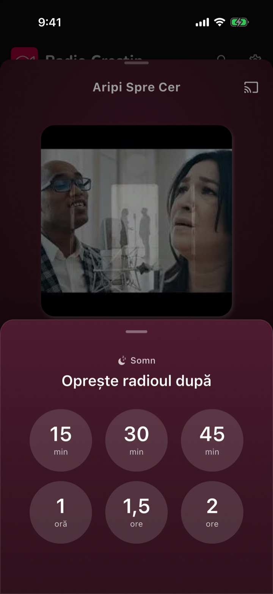
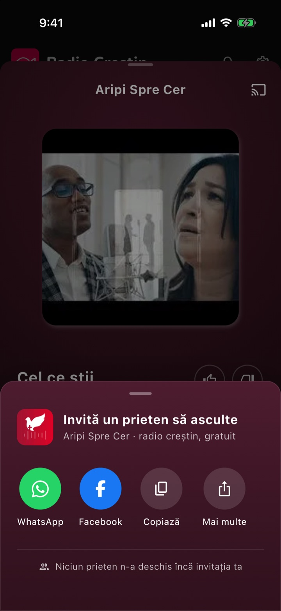
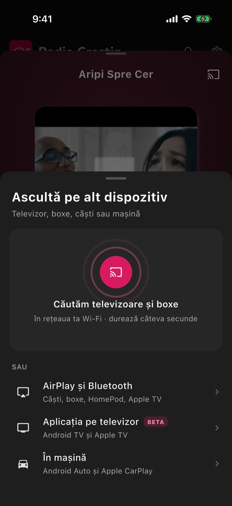

# Radio Crestin 1.6.0

**Status:** not released yet · **Changes since:** [1.5.1](v1.5.1.md) (May 5, 2026) · **Already in the stores as:** 1.5.1 builds 85–101 \
**Platforms:** iPhone, iPad, Android, Android TV, Apple TV, Mac, Windows, CarPlay, Android Auto

<!-- say: Welcome to Radio Crestin, version one point six. It is the biggest update since the app began: Siri, Home Screen widgets, a new player, search by song, and radio that keeps playing when the signal drops. -->

The biggest update since the app began: Siri and Home Screen widgets on iPhone, a redesigned player, search that
finds the song you hear, your own order and hidden stations, reworked CarPlay and Android Auto, a real Mac
app, and playback that rides out a weak or lost signal. Many of these already reached the App Store and Google
Play as 1.5.1 updates; 1.6.0 brings them together on every platform.

## Highlights

### Siri plays any station by voice

<!-- say: On iPhone you can now just ask. Say: Hey Siri, play R V E Constanta on Radio Crestin. It works with the app closed, and from the car's voice button. Say my favorites to play your favorites. -->

- "Hey Siri, play *RVE Constanța* on Radio Creștin": also with the app closed, and from the car's voice button.
- Siri learns the Romanian station names; a name heard slightly off still finds the station.
- "My favorites" plays your favorites; no station name resumes the last one.

### Home Screen widgets on iPhone

<!-- say: There are new Home Screen widgets. Now Playing shows the song you hear, with play, pause, and the next and previous stations. The Favorites widget starts a favorite with one tap, without opening the app. -->

- **Acum ascult** (small and medium): the song you hear, as on the lock screen, with play/pause and the
  previous and next stations; when stopped, the last station and how many are listening.
- **Favorite** (medium): one tap starts a favorite, and the one playing is ringed.
- From iOS 17 the buttons work without opening the app.

### A new full player

<!-- say: The full player is redesigned. Sharp artwork, like and dislike right next to the song, and one row for favorite, sleep timer, share, and song history. Tap the song to search it on YouTube, or hold it to copy it. -->

- Sharp artwork, with like and dislike beside the song title.
- One row of actions: **favorit**, **somn**, **trimite**, **istoric** (song history).
- Tap the title or artist to search the song on YouTube; hold it to copy "title - artist".
- Landscape layouts for phones and tablets, with the artwork on the left and the controls on the right.

### Search finds the song you hear

<!-- say: Search now happens right on Home. Type a station name, or the title or singer of a song, and the list narrows as you type. Stations playing that song show up, with the matching words in bold. Diacritics don't matter. -->

- Tap search: the bar turns into a field, and the list narrows as you type.
- Finds stations by name **and** by the song on now (title or singer), with the matching words in bold.
- Case, diacritics and punctuation don't matter.

### Categories, hidden stations and your own order

<!-- say: Categories now show as a grid of picture cards, each with its number of stations. Hold a station to hide it, with undo, and find it again in Settings. And you can drag your favorites into your own order, which CarPlay, Android Auto and the T V follow too. -->

 

- Categories show as a grid of cards with a picture and their number of stations.
- Hold a station → **Ascunde stația** hides it everywhere (list, search, CarPlay, Android Auto), with undo;
  **Setări → Stații ascunse** brings it back.
- Hold a favorite and drag it to reorder; next/previous, CarPlay, Android Auto, widgets and TV keep that order.
- Favorites now stay in the full station list as well.

### Keeps playing through a weak signal

<!-- say: Radio keeps playing when the signal drops. With preload set to two or five minutes, the app starts that far behind live and keeps that much audio ready. On iPhone, a lost connection no longer skips what was loaded. And a new setting, Use MP3 first, helps if a station stops or won't start. -->

- **Încărcare în avans** (2 or 5 minutes) starts that far behind live and keeps that much audio loaded, so
  short drops go unheard; on iPhone an outage no longer skips what was loaded.
- A short pause in the background (a call, headphones out, the car connecting) keeps the loaded audio.
- The app checks for real internet, not just Wi-Fi, and resumes as soon as the connection comes back.
- New **Folosește MP3 cu prioritate**: for listeners whose station stops or won't start, load the MP3 stream first.

### CarPlay and Android Auto, reworked

<!-- say: In the car, CarPlay and Android Auto now have two tabs: Favorites and Categories. Station logos are there as soon as a list opens. Android Auto gets like and dislike buttons, and both show a clear message when there is no internet. -->

- Two tabs: **Favorite** and **Categorii** (starting with **Toate radiourile**); next/previous stay within the list.
- Station logos load ahead, so lists open with their pictures.
- Android Auto gets 👍 ♡ 👎 on Now Playing, and its lists no longer jump to the top when the song changes.
- Both show a clear no-internet message instead of an endless spinner; "Redate recent" follows the station.

### Sleep timer, sharing and other devices

<!-- say: The sleep timer is one tap: fifteen minutes up to two hours, with a live countdown and a gentle fade. Sharing has a new sheet for WhatsApp, Facebook, or a copied invitation. And the cast button lists Chromecast, AirPlay, the T V app and the car in one place. -->

  

- **Somn**: one tap from 15 minutes to 2 hours, a live countdown and a volume fade at the end.
- **Invită un prieten**: WhatsApp, Facebook, copy or more; the copied text carries the station, the song and the link.
- **Ascultă pe alt dispozitiv**: Chromecast devices found on your Wi-Fi, plus AirPlay, the TV app and the car.

### A real Mac app, and a better Apple TV

<!-- say: On the Mac, Radio Crestin is now a real desktop app, with a station grid, a player bar with volume, menus and keyboard shortcuts. On Apple TV, the app now joins the same App Store app as the iPhone, with preload, favorites and song likes. -->

- **Mac:** station grid with categories and search, a player bar with volume and mute that opens into
  **Se redă acum**, menu bar, Dock menu and keyboard shortcuts; ready for the Mac App Store.
- **Apple TV:** part of the same App Store app as the iPhone; **Încărcare în avans**, song likes, favorites
  (click and hold a card), system Now Playing and Top Shelf images; HLS stations play again.

## More improvements

### Look and feel

<!-- say: Smaller touches everywhere. Song titles start with a capital letter, the mini player is burgundy in the light theme, and Android draws behind a see-through navigation bar. The station list also stays readable with large text. -->

- Song titles and artists start with a capital letter everywhere (keeping names like *iBelieve*).
- The mini player is burgundy in the light theme; the playing station's card is a soft grey.
- Settings slides in like a native page and can be swiped back from the edge.
- On Android 10+ the app draws behind a see-through navigation bar.
- Station cards grow with larger text sizes instead of overflowing; bigger touch areas on Home.
- Songs no longer show a moment late or early when you switch stations.

### Ready for TV and playlist stations

<!-- slides: skip -->

- The app can play video (TV) stations and playlists, including YouTube playlists, with a quality picker and
  fullscreen, on the phone, in the car (as audio), on Android TV and on the desktop. Stations can start
  publishing them whenever they are ready.

## Fixes

### Playback

<!-- say: Many playback fixes. Android 12 and older no longer closes when playback starts. The play button no longer flickers on iPhone. A silent stream no longer shows as playing. And on Android, a slow start on mobile data now gets more time before falling back. -->

- Android 12 and older: the app no longer closes as soon as playback starts.
- iPhone: the play button no longer flickers or stays on the spinner while audio plays.
- A silent stream no longer shows as playing after an interruption or a resume.
- The last station no longer restarts right after the app opens and plays.
- Android: HLS stations get 10 s to start on mobile data, and stalls are left to the player for 15 s before a reload.
- iPhone: HLS stations no longer jump back about 18 seconds and repeat audio.

### Smoothness and other fixes

<!-- say: The app is also smoother on slower Android phones: scrolling, switching stations, and opening sheets no longer drop frames. Pictures that failed to load come back with the internet, and the settings page no longer opens blank. -->

- Scrolling the station list, switching stations and opening sheets no longer drop frames on slower Android phones.
- Station pictures that failed to load come back when the internet does (app, CarPlay, lock screen).
- The settings page no longer opens blank.
- The player panel no longer stays stuck half open after an interrupted swipe.
- The CarPlay and share cards on Home show one at a time; the car card hides once you've used the car.

## Under the hood

<!-- slides: skip -->

For developers; nothing here changes what listeners see.

- Flutter 3.47.7 (pinned in `.fvmrc`); Android targets API level 36 (Android 16) and needs Android 7.0+.
- PostHog is the only analytics and error tracking layer, in its own project; playback failures are reported
  as errors; iOS dSYMs are uploaded on every iOS release build.
- Every phone gets its own device ID, kept across reinstalls (Android `ANDROID_ID`, iOS Keychain).
- Default settings for new installs come from the `mobile-default-settings` PostHog flag until the listener
  changes them.
- Release tooling: `make deploy`, `deploy-ios`, `deploy-android`, `release-stores`; this release-notes folder,
  and the narrated presentation (`make release-media`).
- Removed: the NFC tag writing page (opening the app from an NFC tag still works) and unused packages.

## Install and set up

<!-- slides: skip -->

Every device, from iPhone to Android Auto: [SETUP.md](SETUP.md).
